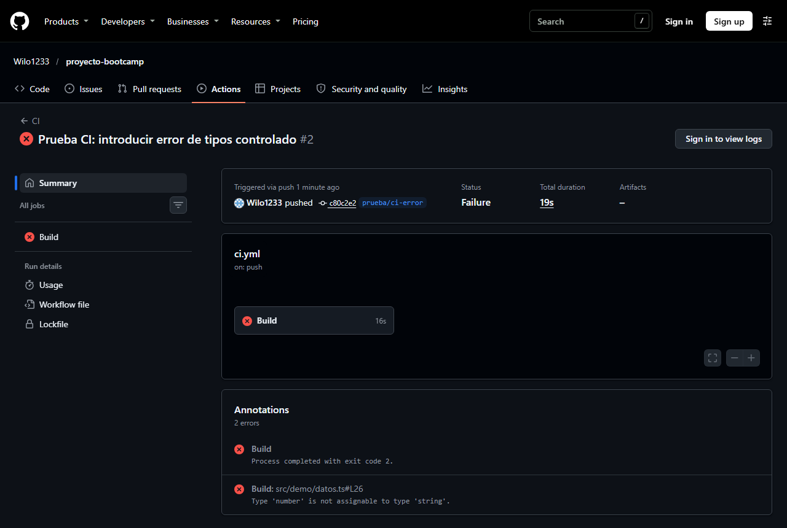
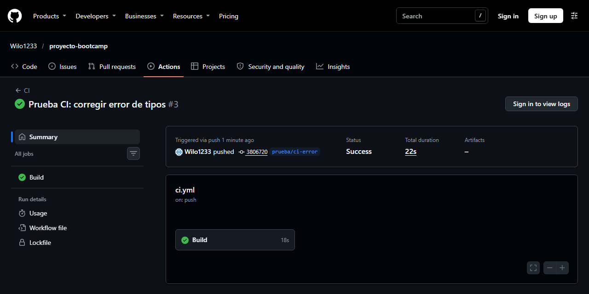

# Taller 5 — Integración continua con GitHub Actions

## 1. Identificación

| Campo | Dato |
|---|---|
| Autor | Wilson Ortiz (trabajo individual) |
| Proyecto | Consultorio Médico Privado (repositorio `proyecto-bootcamp`) |
| Cohorte | CB PFSD4 · VI Cohorte Frontend React |
| Entrega | **Taller 5 · Pipeline de CI con GitHub Actions** |
| Fecha | 24 de noviembre de 2026 |
| Repositorio | <https://github.com/Wilo1233/proyecto-bootcamp> |
| Workflow | <https://github.com/Wilo1233/proyecto-bootcamp/actions/workflows/ci.yml> |

## 2. El pipeline

El workflow `.github/workflows/ci.yml` se ejecuta en cada `push` y en cada `pull_request`, con permisos de solo lectura. Un único trabajo («Build», `ubuntu-latest`) sigue estos pasos:

1. `actions/checkout@v7` descarga el código.
2. `pnpm/action-setup@v6` instala pnpm; no lleva `version` porque la toma del campo `packageManager` de `package.json` (`pnpm@11.17.0`).
3. `actions/setup-node@v7` instala Node 24 y guarda en caché el almacén de pnpm.
4. `pnpm install --frozen-lockfile` instala exactamente lo que fija `pnpm-lock.yaml`.
5. `pnpm build` ejecuta `tsc -b && vite build`: primero comprueba los tipos y después compila.

## 3. Prueba con error: ejecución fallida

En la rama `prueba/ci-error` cambié a propósito la línea 26 de `src/demo/datos.ts`: el campo `id` de una especialidad pasó de `'general'` a `42`. La interfaz `Especialidad` declara `id: string`, así que TypeScript rechaza el número. La rama nunca se fusionó con `main`.

```
$ tsc -b && vite build
##[error]src/demo/datos.ts(26,5): error TS2322: Type 'number' is not assignable to type 'string'.
[ELIFECYCLE] Command failed with exit code 2.
##[error]Process completed with exit code 2.
```

El pipeline falló en el paso **Build**; los pasos de instalación terminaron bien. GitHub marcó el error como anotación sobre `src/demo/datos.ts`, línea 26 (captura 1). Ejecución: <https://github.com/Wilo1233/proyecto-bootcamp/actions/runs/45527431210>



## 4. Corrección: ejecución exitosa

La solución fue restaurar `id: 'general'` en la misma rama y subir el cambio. El código volvió a ser idéntico al de `main`; el pipeline se ejecutó de nuevo y terminó en verde (captura 2). Ejecución: <https://github.com/Wilo1233/proyecto-bootcamp/actions/runs/45527507707>



## 5. Resumen de ejecuciones

| Rama | Commit | Resultado | Ejecución |
|---|---|---|---|
| `main` | `b00c09a` Agregar pipeline de CI con GitHub Actions | Éxito | [45527350114](https://github.com/Wilo1233/proyecto-bootcamp/actions/runs/45527350114) |
| `prueba/ci-error` | `c80c2e2` Introducir error de tipos controlado | **Fallo** (TS2322) | [45527431210](https://github.com/Wilo1233/proyecto-bootcamp/actions/runs/45527431210) |
| `prueba/ci-error` | `3806720` Corregir error de tipos | Éxito | [45527507707](https://github.com/Wilo1233/proyecto-bootcamp/actions/runs/45527507707) |

**Conclusión.** El pipeline detecta un error de tipos antes de que llegue a `main`, indica el archivo y la línea exactos, y vuelve a verde cuando se corrige.
