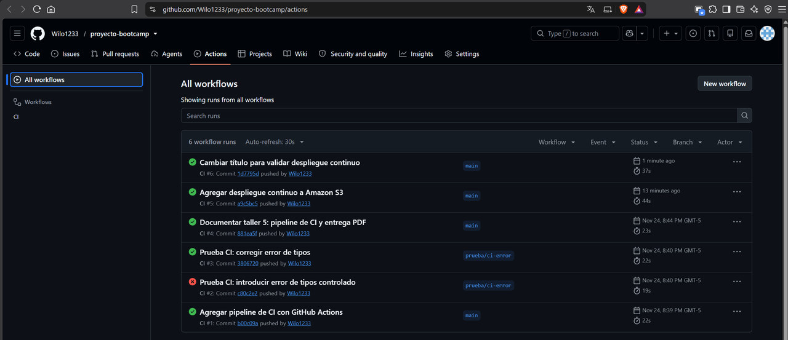
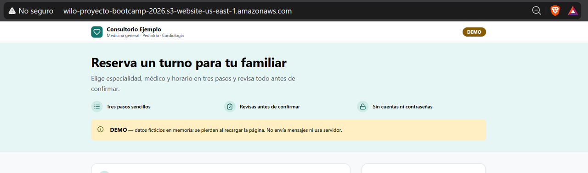
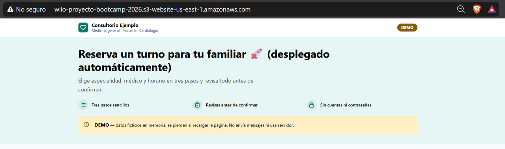

# Taller 7 — Despliegue continuo en Amazon S3 con GitHub Actions

> Estado: **desplegado y verificado**. El sitio está publicado en Amazon S3 y se comprobó el despliegue continuo con un cambio visual real: el commit `1d7795d` cambió el título de la demo, el pipeline lo desplegó solo y el sitio mostró el título nuevo. Los datos de esta entrega salen de ejecuciones reales de GitHub Actions; la entrega en PDF está en [`taller-07-cd.pdf`](taller-07-cd.pdf).

## 1. Identificación

| Campo | Dato |
|---|---|
| Autor | Wilson Ortiz (trabajo individual) |
| Proyecto | Consultorio Médico Privado (repositorio `proyecto-bootcamp`) |
| Cohorte | CB PFSD4 · VI Cohorte Frontend React |
| Entrega | **Taller 7 · Despliegue continuo (CD) en Amazon S3** |
| Fecha | 26 de noviembre de 2026 |
| Repositorio | <https://github.com/Wilo1233/proyecto-bootcamp> |
| Workflow | <https://github.com/Wilo1233/proyecto-bootcamp/actions/workflows/ci.yml> |
| Sitio publicado | <http://wilo-proyecto-bootcamp-2026.s3-website-us-east-1.amazonaws.com> (HTTP; formato `http://<bucket>.s3-website-<región>.amazonaws.com`) |

## 2. El pipeline

El workflow `.github/workflows/ci.yml` sigue ejecutándose en cada `push` y en cada `pull_request`, con permisos de solo lectura. Ahora tiene dos trabajos.

**Trabajo «Build»** (el del Taller 5, con un paso más al final):

1. `actions/checkout@v7` descarga el código.
2. `pnpm/action-setup@v6` instala pnpm (la versión sale de `packageManager`).
3. `actions/setup-node@v7` instala Node 24 y guarda en caché el almacén de pnpm.
4. `pnpm install --frozen-lockfile` instala exactamente lo que fija `pnpm-lock.yaml`.
5. `pnpm build` ejecuta `tsc -b && vite build` y deja el resultado en `dist/`.
6. **Nuevo:** «Subir artefacto» (`actions/upload-artifact@v4`) guarda `dist/` como artefacto de la ejecución con el nombre `react-build`.

**Trabajo «Deploy AWS S3»** (nuevo, `needs: build`):

1. «Descargar artefacto» (`actions/download-artifact@v4`) recupera `react-build` en `dist/`. Así se publica exactamente lo que compiló «Build», sin volver a compilar.
2. «Configurar credenciales AWS» (`aws-actions/configure-aws-credentials@v4`) toma las credenciales de los secretos y la región de una variable (sección 4).
3. «Verificar identidad AWS» ejecuta `aws sts get-caller-identity` para comprobar que las credenciales sirven antes de tocar el bucket.
4. «Desplegar en Amazon S3» ejecuta `aws s3 sync dist/ s3://${{ vars.S3_BUCKET_NAME }}`.

## 3. Cuándo se despliega

El trabajo «Deploy AWS S3» lleva la condición `github.ref == 'refs/heads/main' && github.event_name != 'pull_request'`:

| Evento | «Build» | «Deploy AWS S3» |
|---|---|---|
| `push` a `main` | Se ejecuta | **Se ejecuta** |
| `push` a otra rama | Se ejecuta | Se omite |
| `pull_request` | Se ejecuta | Se omite |

Si «Build» falla, «Deploy AWS S3» no arranca (`needs: build`): un error de tipos o de compilación nunca llega al bucket.

## 4. Preparación (una sola vez)

### 4.1. Infraestructura en AWS

Se hace a mano en la consola de AWS:

1. Crear un bucket de S3 en la región elegida.
2. En «Propiedades» del bucket, activar **Alojamiento de sitios web estáticos** (*Static website hosting*) con `index.html` como documento de índice. La demo es una sola pantalla sin rutas, así que no hace falta documento de error.
3. En «Permisos», desactivar **Bloquear todo el acceso público** (*Block Public Access*) y confirmar el aviso. Sin esto la política del paso siguiente no se puede aplicar.
4. En «Permisos» → «Política del bucket», permitir la lectura pública de los objetos (plantilla; hay que sustituir `<nombre-del-bucket>`):

   ```json
   {
     "Version": "2012-10-17",
     "Statement": [
       {
         "Sid": "LecturaPublica",
         "Effect": "Allow",
         "Principal": "*",
         "Action": "s3:GetObject",
         "Resource": "arn:aws:s3:::<nombre-del-bucket>/*"
       }
     ]
   }
   ```

La dirección del sitio tiene el formato `http://<bucket>.s3-website-<región>.amazonaws.com` (sin HTTPS: el alojamiento de sitios web de S3 solo sirve HTTP). Si el sitio responde 403, revisa que la política del bucket sea esta y no bloquee el acceso por HTTP (ver 5.4).

### 4.2. Secretos y variables en GitHub

En el repositorio: «Settings» → «Secrets and variables» → «Actions». Aquí solo se nombran; **los valores nunca se escriben en el repositorio ni en la documentación**.

| Nombre | Tipo | Qué contiene |
|---|---|---|
| `AWS_ACCESS_KEY_ID` | Secreto | Identificador de la clave de acceso |
| `AWS_SECRET_ACCESS_KEY` | Secreto | Clave secreta de acceso |
| `AWS_SESSION_TOKEN` | Secreto | Token de sesión de las credenciales temporales |
| `AWS_REGION` | Variable | Región del bucket (por ejemplo, la que muestra la consola) |
| `S3_BUCKET_NAME` | Variable | Nombre del bucket, sin `s3://` |

**Las credenciales caducan.** Al haber `AWS_SESSION_TOKEN`, son credenciales temporales de AWS Academy: cambian en cada sesión del laboratorio y dejan de valer cuando esta termina. Antes de cada despliegue hay que iniciar el laboratorio, copiar de nuevo las tres credenciales y actualizar los tres secretos. Con credenciales vencidas, el despliegue falla en el paso de credenciales o en `aws s3 sync`; no hay que cambiar el workflow, solo renovar los secretos.

## 5. Evidencia de la ejecución

Los datos son de ejecuciones reales del repositorio; todo lo de esta sección se puede comprobar en la pestaña Actions y abriendo la URL pública.

| Evidencia | Dato |
|---|---|
| Despliegue inicial (CI #5) | Commit `a9c5bc5` «Agregar despliegue continuo a Amazon S3» en `main`: «Build» 28 s y «Deploy AWS S3» 11 s, ambos en verde (44 s en total). Ejecución: <https://github.com/Wilo1233/proyecto-bootcamp/actions/runs/45922390920> |
| URL pública del sitio | <http://wilo-proyecto-bootcamp-2026.s3-website-us-east-1.amazonaws.com> (responde 200) |
| Cambio visual (CI #6) | Commit `1d7795d` «Cambiar título para validar despliegue continuo» en `main`: éxito. Ejecución: <https://github.com/Wilo1233/proyecto-bootcamp/actions/runs/45923582000> |
| Bundle publicado | `assets/index-CFIf3jOZ.js` antes del cambio; `assets/index-w_drP2oF.js` después (Vite cambia el nombre cuando cambia el contenido) |

### 5.1. Pipeline exitoso

La captura 1 es la pestaña Actions con las ejecuciones de «CI»: **CI #5** (`a9c5bc5`, el primer despliegue) y **CI #6** (`1d7795d`, el cambio visual) en verde, sobre las del Taller 5 (la roja, `CI #2`, es la prueba con error de ese taller).



### 5.2. Antes del cambio

Tras CI #5 el sitio ya estaba publicado en la URL pública. El título de la demo era «Reserva un turno para tu familiar» (captura 2).



### 5.3. El cambio y el despliegue automático

El cambio es una sola línea visible: en `src/demo/Marco.tsx` el título pasó de «Reserva un turno para tu familiar» a «Reserva un turno para tu familiar 🚀 (desplegado automáticamente)». Se subió a `main` con el commit `1d7795d`; el pipeline corrió solo (CI #6, éxito) y, sin tocar nada más, el sitio mostró el título nuevo (captura 3). El archivo principal publicado cambió de `index-CFIf3jOZ.js` a `index-w_drP2oF.js`.



### 5.4. Incidente resuelto: respuesta 403

Durante la preparación, el sitio respondió 403 (acceso denegado): la política que tenía el bucket entonces bloqueaba el acceso por HTTP, y el endpoint de sitio web de S3 solo sirve HTTP. Se reemplazó por una política simple de lectura pública, con `Allow` a `*` sobre `s3:GetObject` (la plantilla de la sección 4.1), y el sitio pasó a responder 200. No hizo falta cambiar el workflow.

Las capturas no muestran datos de la cuenta de AWS ni valores de secretos; en la documentación tampoco hay identificadores de cuenta ni ARN.

## 6. Resumen de ejecuciones

| Rama | Commit | Resultado | Ejecución |
|---|---|---|---|
| `main` | `a9c5bc5` Agregar despliegue continuo a Amazon S3 (CI #5, primer despliegue) | Éxito: «Build» 28 s y «Deploy AWS S3» 11 s | [45922390920](https://github.com/Wilo1233/proyecto-bootcamp/actions/runs/45922390920) |
| `main` | `1d7795d` Cambiar título para validar despliegue continuo (CI #6, cambio visual) | Éxito | [45923582000](https://github.com/Wilo1233/proyecto-bootcamp/actions/runs/45923582000) |

## 7. Límites conocidos

- **Sin `--delete`:** `aws s3 sync` copia lo nuevo y lo modificado pero no borra del bucket lo que ya no existe en `dist/`. Como Vite cambia el nombre de los archivos de `assets/` en cada compilación, los archivos viejos se acumulan en el bucket (no afectan al sitio, solo ocupan espacio). Se dejó sin `--delete` a propósito, para seguir el taller tal como está planteado y no borrar nada del bucket sin querer.
- **Acciones en Node 20:** `upload-artifact@v4`, `download-artifact@v4` y `configure-aws-credentials@v4` declaran Node 20, que GitHub marca como obsoleto: la ejecución puede mostrar un aviso de deprecación (el resto del workflow usa Node 24). Hay versiones más nuevas (el 26 de noviembre de 2026: `upload-artifact` v7.0.2, `download-artifact` v8.0.2 y `configure-aws-credentials` v6.3.1); se mantuvieron las `@v4` del taller y subir de versión queda como mejora.
- **Solo HTTP:** el alojamiento de sitios web de S3 no ofrece HTTPS; hacerlo requeriría CloudFront, fuera del taller.
- **Credenciales temporales:** cada sesión del laboratorio exige renovar los tres secretos (sección 4.2).

**Conclusión.** El despliegue continuo funciona de punta a punta: un `push` a `main` compila la demo, guarda `dist/` como artefacto y «Deploy AWS S3» lo publica en el bucket sin pasos manuales. Lo comprobó un cambio real: el commit `1d7795d` cambió el título en `src/demo/Marco.tsx`, CI #6 terminó en verde y el sitio público pasó a mostrar el título nuevo, con otro archivo principal (`index-CFIf3jOZ.js` → `index-w_drP2oF.js`). El único tropiezo fue un 403 al abrir el sitio, que se resolvió reemplazando la política del bucket por una de lectura pública simple.
