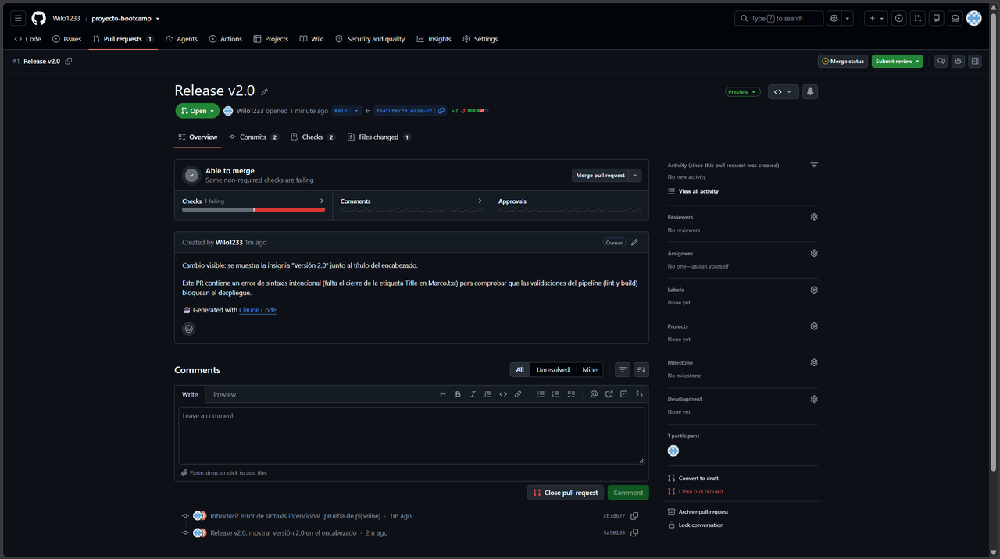
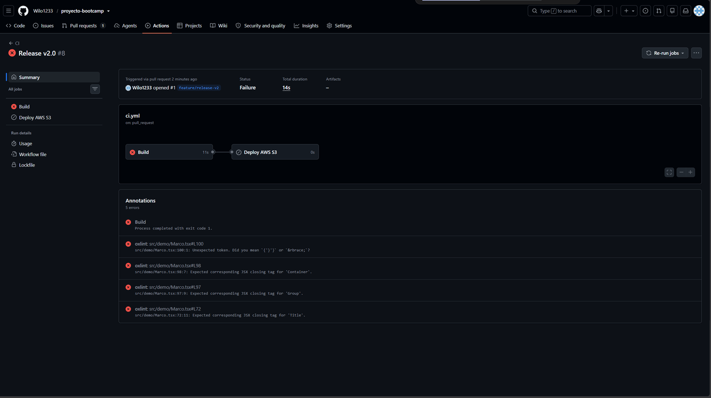
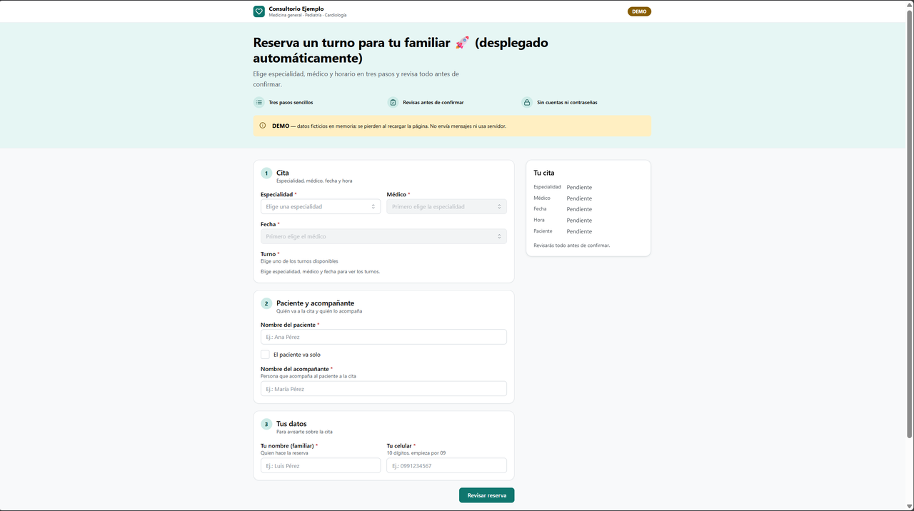
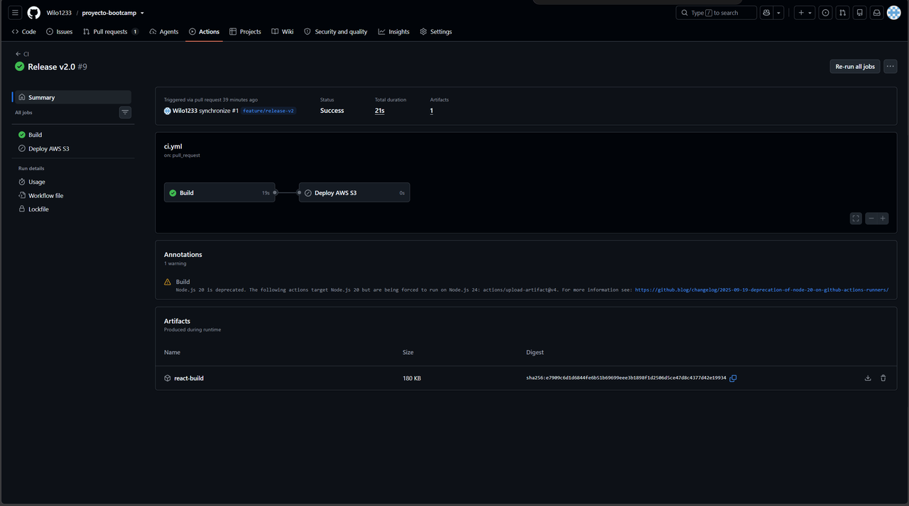
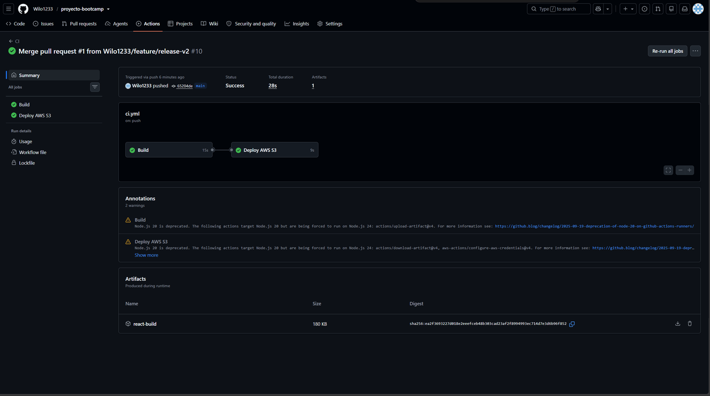
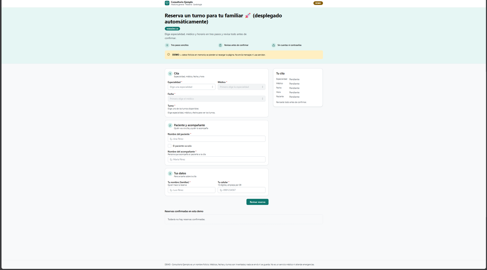

# Taller 8 — Despliegue seguro y control de versiones

> Estado: **comprobado de punta a punta**. Un PR con un error de sintaxis intencional fue bloqueado por el pipeline sin tocar el sitio; tras corregirlo y fusionarlo, el pipeline publicó la «Versión 2.0». Los datos salen de ejecuciones reales de GitHub Actions.

## 1. Identificación

| Campo | Dato |
|---|---|
| Autor | Wilson Ortiz (trabajo individual) |
| Proyecto | Consultorio Médico Privado (repositorio `proyecto-bootcamp`) |
| Entrega | **Taller 8 · Despliegue seguro y control de versiones** |
| Fecha | 27 y 28 de noviembre de 2026 |
| Repositorio | <https://github.com/Wilo1233/proyecto-bootcamp> |
| Pull request | <https://github.com/Wilo1233/proyecto-bootcamp/pull/1> |
| Workflow | <https://github.com/Wilo1233/proyecto-bootcamp/actions/workflows/ci.yml> |
| Sitio publicado | <http://wilo-proyecto-bootcamp-2026.s3-website-us-east-1.amazonaws.com> |

## 2. Controles implementados

Todos están en `.github/workflows/ci.yml`. El objetivo es que nada llegue al sitio sin pasar por una validación y sin estar en `main`.

**Disparadores.** Todo PR hacia `main` se valida; el `push` solo cuenta en `main`:

```yaml
on:
  push:
    branches: [main]
  pull_request:
    branches: [main]
    types: [opened, synchronize, reopened]
```

**Validaciones en «Build».** Además de compilar, el trabajo ejecuta `pnpm lint` (oxlint) antes de `pnpm build`; si alguno falla, el trabajo termina en rojo.

**Deploy depende de Build y solo corre en `main`:**

```yaml
deploy:
  needs: build
  if: github.event_name == 'push' && github.ref == 'refs/heads/main'
```

- `needs: build`: si «Build» falla, «Deploy AWS S3» no arranca.
- `if: ... push ... main`: un PR nunca despliega, aunque «Build» salga en verde.

| Evento | «Build» (lint + build) | «Deploy AWS S3» |
|---|---|---|
| `pull_request` hacia `main` | Se ejecuta | Se omite |
| `push` a `main` | Se ejecuta | Se ejecuta solo si «Build» pasó |

## 3. Evidencia

Rama `feature/release-v2`, PR #1 «Release v2.0»: un cambio visible (la insignia «Versión 2.0» junto al título, en `src/demo/Marco.tsx`).



### Paso 1 — Versión con error: el pipeline bloquea

El commit `cb3d627` dejó sin cerrar la etiqueta `Title`. El lint lo detectó (`Marco.tsx:72:11 Expected corresponding JSX closing tag for 'Title'`), «Build» falló, «Deploy AWS S3» quedó omitido y el sitio siguió con la versión anterior (captura 3). Ejecución: <https://github.com/Wilo1233/proyecto-bootcamp/actions/runs/46106983029>.





### Paso 2 — Corrección: el PR valida, pero no despliega

El commit `e3cee48` cerró la etiqueta. «Build» pasó y «Deploy AWS S3» se omitió porque el evento es un PR. El sitio seguía sin «Versión 2.0» (se comprobó en el bundle publicado). Ejecución: <https://github.com/Wilo1233/proyecto-bootcamp/actions/runs/46107362106>.



### Paso 3 — Fusión a `main`: el pipeline despliega

Se fusionó el PR (commit de fusión `65204de`, sin borrar la rama). El `push` a `main` disparó el pipeline: «Build» y «Deploy AWS S3» terminaron en verde. Ejecución: <https://github.com/Wilo1233/proyecto-bootcamp/actions/runs/46110469609>.



### Paso 4 — Versión 2.0 publicada

El sitio ahora carga `assets/index-DzYFkNZ5.js` (antes `index-w_drP2oF.js`) y ese archivo contiene «Versión 2.0».



## 4. Resumen de ejecuciones

| Evento | Commit | Resultado | Ejecución |
|---|---|---|---|
| PR #1 (`opened`) | `cb3d627` error de sintaxis intencional | «Build» falló en Lint; «Deploy AWS S3» omitido; sitio sin cambios | [46106983029](https://github.com/Wilo1233/proyecto-bootcamp/actions/runs/46106983029) |
| PR #1 (`synchronize`) | `e3cee48` corrección | «Build» éxito; «Deploy AWS S3» omitido; sitio sin cambios | [46107362106](https://github.com/Wilo1233/proyecto-bootcamp/actions/runs/46107362106) |
| `push` a `main` | `65204de` fusión del PR #1 | «Build» éxito; «Deploy AWS S3» éxito; sitio con «Versión 2.0» | [46110469609](https://github.com/Wilo1233/proyecto-bootcamp/actions/runs/46110469609) |

**Conclusión.** Los dos controles funcionan: un error en un PR se detiene en «Build» y no llega al sitio, y un PR sano se valida pero solo se despliega al fusionarlo en `main`. No hizo falta cambiar el workflow durante la prueba. Las credenciales de AWS Academy son temporales; con ellas vencidas el despliegue fallaría en el paso de credenciales, y bastaría renovar los secretos (ver el Taller 7).
